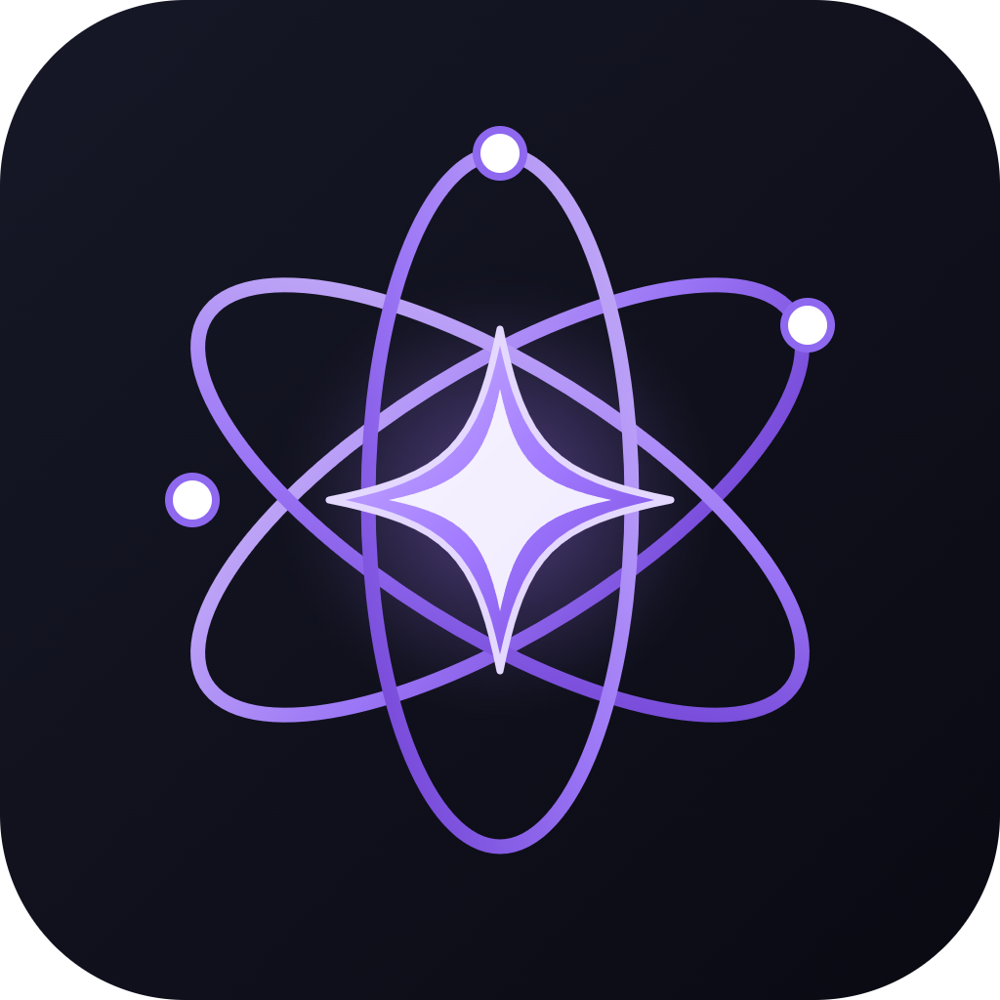

# Ultimate Toolkit
### (AI Assistant, Encryption & Security, Notes & PDF Reader, Text-to-Speech, Formatting, Callouts, Image Editing, RTL/LTR, Workspace Focus, Folder Customization & More)

**The All-in-One Powerhouse for Obsidian: Privacy, Artificial Intelligence, Smart Reading & Workflow Mastery.**

  

---

**Ultimate Toolkit** is a comprehensive, production-grade Obsidian plugin engineered to eliminate friction from daily academic study, knowledge management, and intensive note-taking. Rather than installing dozens of disjointed plugins, Ultimate Toolkit unifies military-grade folder encryption, natural bilingual text-to-speech for books and notes, Live Preview image controls, a universal AI streaming engine, Notion-style selection toolbars, and workspace organization utilities into a single, lightning-fast suite with zero memory leaks.

---

## ⚡ Feature Matrix at a Glance

| Module | Core Capability | Triggers & Shortcuts |
| :--- | :--- | :--- |
| 🗣️ **Universal Natural TTS & Reader** | High-fidelity voice narration for **Markdown notes, HTML book chapters, and PDFs**. Dual-engine (Microsoft Natural Online + Piper/OneCore offline), bilingual segmentation, and floating mini-player. | `Alt+S` / Ribbon icon / Selection toolbar |
| 🔒 **Encrypted Folder Vault** | Military-grade folder privacy with **PBKDF2-SHA-256** key derivation. Intercepts global search and quick switcher to prevent leaks. Inactivity & blur auto-lock. | Right-click any folder |
| ✨ **Floating Selection Toolbar 2.0** | Notion-style floating toolbar on text selection. Features **Adaptive Modes**: full formatting & callouts in editor; sleek Reader mode (TTS, AI, Copy) in HTML books, PDFs, and reading view. | Select text in any view |
| 🤖 **Universal AI Engine** | Real-time SSE word-by-word streaming supporting **Google Gemini, OpenAI, Claude, Ollama (Local), LM Studio, and custom OpenAI endpoints**. Auto model detection. | `Ctrl+Shift+G` / Selection toolbar |
| 🖼️ **Live Preview Image Controls** | Floating control HUD directly over images in Live Preview & Reading view. Size presets (25%–100%), fine increments (+/- 50px), alignment, rotation, and fullscreen lightbox. | Hover/click any image |
| 🎯 **Workspace Focus Mode 2.0+** | Isolate active working folders in the file explorer. Displays dynamic note count statistics in breadcrumbs with complete Arabic/Unicode path support. | `Alt+F` / Left ribbon |
| 📝 **Notion-Style Slash Commands** | Type `/` at the start of any line to instantly insert callouts, dividers, RTL blocks, or custom templates. | Type `/` in editor |
| 🎨 **Academic Formatting Palette** | Over 60 beautifully styled callouts, dividers, bilingual layouts, and structural tags. | `Ctrl+Shift+F` |
| 🌐 **Instant RTL / LTR Direction** | Seamless paragraph direction toggling for bilingual notes (Arabic & English mixed). | `Alt+R` |
| 🚨 **Emergency Panic Lock** | Instant emergency hotkey to immediately close sensitive tabs and lock all protected folders. | `Ctrl+Alt+L` |
| 📁 **Folder Customization & Guides** | Custom folder icons, badge colors, and Apple Notes-style visual hierarchy lines in the file tree. | Right-click folder |

---

## 📖 Deep-Dive Module Architecture

### 1. 🗣️ Universal Natural Text-to-Speech (TTS) & Document Reader
- **Universal Multi-Format Support:** Reads standard **Markdown notes**, **open PDF books**, **embedded PDF previews** (`![[book.pdf]]`), and **HTML book chapters** (such as converted Razavi textbooks via `obsidian-html-plugin` or webviews).
- **Dual-Engine Architecture:**
  - **Online Natural Cloud:** Directly streams high-clarity Microsoft Natural neural audio (Salma for Arabic, Sonia for British English) via Node/requestUrl buffer streaming, completely bypassing Electron renderer CORS/403 blocks.
  - **Offline Natural Hierarchy:** Automatic fallback when offline to top-tier installed voices: prioritizes **Piper neural voices** (`Piper - Cori`, `Piper - Amy`, `Piper - Ryan`) and high-grade British voices (`Hazel`, `Susan`, `George`), strictly demoting robotic legacy voices (Hoda/Zira).
- **Bilingual Intertwined Segmentation:** Dynamically splits mixed sentences on language boundaries, narrating English terminology with native English pronunciation and Arabic context with native Arabic fluency.
- **Comprehensive Text Sanitization:** Strips HTML tags (`
`, `
`, `<script>`, `<style>`), HTML entities (`&rarr;`, `&nbsp;`, `&amp;`), Markdown headers (`#`), arrows (`→`, `←`), bullet points, and LaTeX formulas before synthesis.
- **Draggable Floating HUD Player:** Live sentence preview quote, percentage progress bar, sentence counter (`X / Y`), Previous/Next jump, Play/Pause, and speed toggle (`0.75x`, `1.0x`, `1.25x`, `1.5x`, `2.0x`).
- **Flexible Playback Modes:**
  - **Read Selection (`stRead`):** Reads currently highlighted text in any view.
  - **Read from Here (`stReadFromHere`):** Starts at current cursor position or highlighted text and continuously reads to the end of the chapter/document.
  - **Read Entire Document:** Reads active note, chapter, or visible PDF pages.

---

### 2. 🔒 Military-Grade Folder Vault & Privacy Lock
- **Cryptographic Security:** Derives 256-bit AES keys using standard **Web Crypto PBKDF2 with SHA-256** (100,000 iterations, 16-byte random salt).
- **Zero Plaintext Footprint:** Passwords and PINs are never stored in plaintext on disk; only the salt and secure hash are preserved.
- **Search & Quick Switcher Protection:** Hooks directly into Obsidian's internal search and switcher indexes while locked to ensure private notes and filenames never leak in global search (`Ctrl+Shift+F`) or Quick Switcher (`Ctrl+O`).
- **Configurable Auto-Lock Triggers:** Configurable idle inactivity timeout, window blur trigger (`window.onblur`), and automatic lock on Obsidian startup.
- **Panic Hotkey:** Press `Ctrl+Alt+L` at any moment to immediately close sensitive leaves and re-lock all folders.

---

### 3. ✨ Notion-Style Floating Selection Toolbar 2.0
- **Universal DOM & Iframe Grounding:** Detects selections in Markdown source mode, Live Preview, Reading View, embedded PDFs, and HTML chapter iframes (`#ohpIframe`).
- **Adaptive Mode Switching:**
  - **Editor Mode:** Displays full markdown styling tools (bold, italic, highlight, strike, inline code, wikilinks, callout picker, RTL toggle, AI assist, TTS read aloud).
  - **Reader Mode (HTML Books & PDFs):** Intelligently hides markdown-only formatting and surfaces reader-first controls: `[ 📖 Read Selection ]`, `[ 📄 Read From Here ]`, `[ 🤖 AI Assist ]`, and `[ 📋 Copy ]`.
- **Interactive Callout Dropdown:** Wrap selections into 10 distinct callout types (Note, Tip, Info, Warning, Danger, Success, Question, Quote, Example, Summary). If already inside a callout, seamlessly updates the callout type without duplicating markdown text.

---

### 4. 🤖 Universal AI Assistant with Word-by-Word Streaming
- **Broad Provider Compatibility:** Connect seamlessly to **Google Gemini** (using official `v1beta/openai` endpoint), **OpenAI**, **Ollama (local & private)**, **LM Studio**, **DeepSeek**, **Groq**, or any custom OpenAI-compatible server.
- **Live SSE Streaming:** Responses render in real time without UI locking or freezing.
- **One-Click Quick Actions:** Proofread Arabic/English, summarize into bullet points, explain complex equations, or translate between languages.
- **Auto Model Detection:** Single-click "Test & Fetch Models" button in settings verifies your credentials and auto-populates all models hosted on your endpoint.

---

### 5. 🖼️ Live Preview Image Controls
- Floating interactive controls directly over images in CodeMirror 6 Live Preview and Reading View.
- **Direct Markdown Sync:** Modifies the underlying markdown (`![[diagram.png|400]]`) so dimensions persist across all devices.
- Preset size buttons (25%, 50%, 75%, 100%), fine adjustments (+/- 50px), alignment toggles, rotation (90°), and fullscreen lightbox zoom.

---

### 6. 🎯 Workspace Focus Mode 2.0+ & Folder Customization
- **Declutter Your Workspace:** Hide all unrelated folders in the sidebar to concentrate on the active project or subject.
- **Note Statistics:** Shows note count in breadcrumb headers (e.g. `MSc (14 notes)`). Full support for Arabic and Unicode folder paths.
- **Visual Hierarchy:** Clean, Apple Notes-inspired indentation guidelines and custom folder color/icon badging.

---

## ⌨️ Essential Keyboard Shortcuts

| Shortcut | Action |
| :--- | :--- |
| `Alt + S` | Toggle Text-to-Speech Play / Pause |
| `Ctrl + Shift + G` | Open AI Assistant |
| `Ctrl + Shift + F` | Open Formatting Palette |
| `Ctrl + Shift + T` | AI Template Generator |
| `Ctrl + Shift + Z` | Toggle Fullscreen Note Mode |
| `Alt + F` | Toggle Folder Focus on current note |
| `Alt + R` | Toggle RTL / LTR paragraph direction |
| `Ctrl + Alt + L` | Panic Lock: Lock all folders & close sensitive tabs |
| `/` | Open Notion-Style Slash Commands |

---

## ☕ Support & Community

If **Ultimate Toolkit** enhances your daily productivity, study sessions, or reading experience, please consider supporting its active development:

  

- 💡 **Suggestions & Bug Reports:** [GitHub Issues](https://github.com/ahmdmusa/obsidian-toolkit/issues)
- ✉️ **Direct Feedback:** [ahmedmousa.eng+ObsToolkit@gmail.com](mailto:ahmedmousa.eng+ObsToolkit@gmail.com?subject=Ultimate%20Toolkit%20Feedback)
- ⭐ **Star the Repository:** [GitHub - Ultimate Toolkit](https://github.com/ahmdmusa/obsidian-toolkit)

---

## 🌍 دليل الاستخدام الشامل بالعربية

إضافة **Ultimate Toolkit** (المعروفة سابقاً باسم FlowKit / My Toolkit) هي أداة شاملة ومفتوحة المصدر مصممة خصيصاً لتوفير تجربة متكاملة تجمع بين **الأمان التام، الذكاء الاصطناعي، القراءة الصوتية الذكية للكتب والملاحظات، والتحكم الاحترافي في التنسيق والصور** داخل أوبسيديان، مع دعم كامل وفوري للغة العربية والاتجاه من اليمين لليسار.

### أهم ميزات الإضافة عملياً:

1. **القارئ الصوتي الذكي (TTS) للملاحظات والكتب وPDF وHTML:**
   - قراءة صوتية فائقة الوضوح للملاحظات، ملفات الـ PDF المفتوحة، ملفات الـ PDF المضمنة (`![[book.pdf]]`)، وفصول الكتب بصيغة HTML (مثل فصول كتب Razavi في Analog CMOS).
   - محرك مزدوج: صوت سحابي طبيعي (صوت سلمى للعربية وصوت سونيا للإنجليزية البريطانية) مع سحب مباشر للبايتات لمنع حظر Electron، وتحويل تلقائي عند انقطاع الإنترنت لأقوى أصوات النظام أوفلاين (أصوات Piper الطبيعية مثل Piper Cori وHazel).
   - تقسيم ذكي للجمل المختلطة: قراءة المصطلح الإنجليزي بنطق إنجليزي فصيح والنص العربي بنطق عربي طبيعي.
   - تنظيف تلقائي للرموز والأسهم وأكواد HTML وعلامات الماركداون قبل النطق.
   - مشغل عائم مصغر أنيق يمكنك تحريكه في أي مكان بالشاشة، مع شريط تقدم ونسب وسرعات مضاعفة (`0.75x` حتى `2.0x`).

2. **الخزنة المشفرة لحماية المجلدات (Folder Vault):**
   - تشفير عسكري لأي مجلد بكلمة مرور أو رقم سري عبر خوارزمية **PBKDF2-SHA-256** (100 ألف دورة تشفير).
   - حجب تام للملفات المقفلة من البحث العام (`Ctrl+Shift+F`) ومن التبديل السريع (`Ctrl+O`).
   - قفل تلقائي عند الخمول أو مغادرة النافذة، وزر طوارئ سريع (`Ctrl+Alt+L`).

3. **شريط التحديد العائم الذكي (Notion-Style 2.0):**
   - يعمل على الملاحظات، كتب الـ HTML، ملفات الـ PDF، ووضع القراءة.
   - وضع متكيف: في المحرر يتيح التنسيق الكامل وإدراج 10 أنواع من صناديق التنبيهات (Callouts) وتبديل اتجاه الكتابة؛ وفي وضع قراءة الكتب يظهر خيارات القراءة السريعة (قراءة المحدد، قراءة من هنا لآخر الفصل، الذكاء الاصطناعي، ونسخ النص).

4. **محرك الذكاء الاصطناعي الشامل والبث المباشر (Universal AI):**
   - اتصال فوري بأي مزود: **Google Gemini**, **OpenAI**, **Ollama (محلي 100%)**, **LM Studio**, أو أي سيرفر مخصص.
   - تدفق حي للكلمات (Streaming) دون تجميد البرنامج.
   - تدقيق لغوي، تلخيص، وتبسيط المفاهيم الصعبة بنقرة واحدة.

5. **التحكم العائم بالصور (Live Preview):**
   - شريط تحكم عائم فوق أي صورة أثناء الكتابة لتعديل المقاس مباشرة وتحديث كود الملاحظة.
   - نسب سريعة، محاذاة، تدوير، وعرض مكبر بملء الشاشة.

6. **وضع التركيز وتنظيم مساحة العمل (Focus Mode 2.0+):**
   - عزل المجلد النشط في شجرة الملفات لإلغاء التشتت البصري.
   - إحصائيات بعدد الملاحظات في شريط المسار مع دعم كامل للمسارات العربية.

---

### الدعم والتطوير

إذا كانت الإضافة تفيدك في دراستك وشغلك اليومي، يمكنك دعم استمرار تطويرها عبر:

  

---

## License

This project is open-source under the [MIT License](LICENSE).
