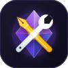

<div align="center">


# ⚡ FlowKit (formerly My Toolkit)

**The all-in-one productivity & privacy engine for Obsidian**

Stay in the flow. Write with power. Protect what matters.

Eight integrated modules — formatting, local AI, image control, navigation, focus mode, and folder encryption — unified in a single, high-performance plugin.

[](https://github.com/ahmdmusa/obsidian-toolkit/releases)
[](https://obsidian.md)
[](LICENSE)
[](https://www.paypal.com/ncp/payment/4SWPEP8Q3YF78)

</div>

---

## Modules at a glance

| | Module | Description | Shortcut / Trigger |
|-|--------|-------------|--------------------|
| 🔒 | **Folder Vault & Privacy Lock** | Protect folders with PBKDF2-encrypted PIN/password & leak prevention | Right-click folder |
| 📁 | **Folder Focus Mode 2.0** | 1-Click zoom into folder, clickable breadcrumbs & quick note | `Alt+F` / 🎯 Ribbon |
| ⚡ | **Slash Commands (/)** | Notion-style inline menu: type `/` to quickly insert any callout or template | `/` in editor |
| 🎨 | **Formatting Palette** | 60+ styled callouts, Islamic RTL elements, dividers & headings | `Ctrl+Shift+F` |
| 🤖 | **AI Smart Suggestion** | Real-time AI continuation powered by local Ollama or OpenAI | `Ctrl+Shift+G` |
| 📐 | **AI Template Generator** | Generate full structured note templates from a description | `Ctrl+Shift+T` |
| 🖼 | **Image Control** | Click-activated toolbar: resize, align, rotate, caption, lightbox | Reading View |
| ⛶ | **Fullscreen Note** | Distraction-free writing mode with optional inactivity auto-trigger | `Ctrl+Shift+Z` |
| 🌳 | **Premium File Tree** | SF Symbols-style icons, visual folder depth & image thumbnails | Sidebar |
| ⚡ | **Quick Access Bar** | Pinned one-click shortcut buttons above the file tree | Sidebar |
| 🎨 | **Folder Colors & Icons** | Customize folder colors & preset icons from the right-click menu | Right-click folder |

---

## 🔒 Folder Vault & Privacy Lock

Protect private or sensitive folders with a custom PIN or password.

- **Military-grade Hashing:** Uses Web Crypto API PBKDF2 with SHA-256 (100,000 iterations + 16-byte cryptographically secure salt). Passwords are never stored in plain text.
- **Obsidian Leak Prevention:** Intercepts `file-open` events for locked files, excluding them from Quick Switcher (`Ctrl+O`) and Global Search (`Ctrl+Shift+F`).
- **Auto-Lock Triggers:** Automatically locks folders after configurable inactivity timeout, when Obsidian loses window focus (`blur`), or on app startup.
- **Clean & Minimal UI:** Sleek unlock dialog without clunky keypads — just enter your password and press **Enter** to instantly unlock and reveal your files.
- **Visual Status Badges:** Displays locked (🔒) and unlocked (🔓) status badges directly in the sidebar tree.

---

## 📁 Folder Focus Mode 2.0

Make any folder feel like the vault root in your sidebar to eliminate visual clutter.

- **1-Click Ribbon Button (🎯):** Focus on the active file's folder with a single click.
- **Keyboard Shortcut (`Alt+F`):** Instantly toggle focus on the current file's folder.
- **Interactive Breadcrumbs:** Navigate folder hierarchies with clickable breadcrumb segments (`Vault › MSc › Courses`).
- **Quick Note Creation:** Direct `+ New note` button in the focus header bar to create notes inside the focused folder immediately.
- **Native Explorer Expansion:** Synchronously expands folders and mounts children without lazy-load blank screen glitches.
- **Full Unicode & Arabic Support:** Works seamlessly with Arabic and non-ASCII folder names.

---

## 🎨 Formatting Palette

Press `Ctrl+Shift+F` to open. Use `↑↓` to navigate, `Enter` to insert, `Esc` to close.


**Categories:** Insert · Callouts · Custom Callouts · Islamic (RTL) · Headings · Text · Lists · Code · Dividers

<details>
<summary>Full category breakdown</summary>

- **Insert:** Current date/time (long, ISO, 24h), dynamic progress bars.
- **Callouts:** Note, Tip, Important, Warning, Caution, FAQ, Summary, Quote, Bug, Example.
- **Custom Callouts:** Academic (Thesis, Theorem, Proof, Definition), Medical (Clinical, Rx, Diagnosis), Engineering (Spec, Constraint).
- **Islamic (RTL):** Bismillah, Duaa, Ayah, Hadith, Hikmah — pre-configured with right-to-left layout and proper typography.
- **Headings & Text:** H1–H6 with styled accent bars, highlighted text, spoilers, badges.
- **Lists & Code:** Multi-column task lists, numbered steps, code blocks with copy indicators.
- **Dividers:** Minimal, dots, gradient, star, diamond separators.

</details>

---

## 🤖 AI Provider (Ollama / OpenAI / Custom)

Integrate AI directly into your writing without third-party dependencies.

### AI Smart Suggestion (`Ctrl+Shift+G`)
Trigger from the editor to generate contextual next sentences based on your surrounding notes.

### AI Template Generator (`Ctrl+Shift+T`)
Describe what you need (e.g., *"Literature review note with methodology and findings"*), and the AI produces a complete Markdown template.

```bash
# Recommended: Local & Private with Ollama
ollama run qwen2.5:3b
```

---

## 🖼 Image Control

Hover or click any image in **Reading View** to access floating controls:

- **Resize:** 25%, 50%, 75%, 100%, or custom pixel width.
- **Alignment:** Left, center, right with clean text wrapping.
- **Rotation:** 90° clockwise/counter-clockwise.
- **Lightbox:** Click to zoom into full resolution with escape-to-close.
- **Captions:** Add styled figure captions stored cleanly in Markdown.

---

## ⛶ Fullscreen Note

Write without distractions.

- **Toggle Shortcut:** `Ctrl+Shift+Z`
- **Floating Button:** Discreet expand button in the upper-right corner.
- **Auto-Fullscreen:** Automatically enters distraction-free mode after 5–120 seconds of typing inactivity.

---

## 🌳 Premium File Tree & ⚡ Quick Access Bar

- **File Tree:** Adds SF Symbols / Lucide folder icons, file-type badges, and automatic image thumbnail previews in the file explorer.
- **Quick Access Bar:** Pin your most frequently accessed notes or folders as persistent quick-launch buttons directly above the file tree.

---

## Keyboard Shortcuts

| Shortcut | Action | Module |
|----------|--------|--------|
| `/` | Open Notion-style Slash Command Suggestion Menu | Slash Commands |
| `Alt + R` | Toggle Line / Selection RTL (Arabic Direction) | Editor Formatting |
| `Ctrl + Alt + L` | Panic Lock: Immediately lock all folders & close tabs | Folder Vault |
| `Alt + F` | Focus / Unfocus current file's folder | Folder Focus Mode |
| `Ctrl + Shift + F` | Open Formatting Palette | Formatting Palette |
| `Ctrl + Shift + Z` | Toggle Fullscreen Note | Fullscreen Note |
| `Ctrl + Shift + G` | AI Smart Suggestion | AI Assistant |
| `Ctrl + Shift + T` | AI Template Generator | AI Assistant |

---

## Settings & Language Support

- **Primary Language:** English by default across all menus, tooltips, dialogs, and notices.
- **Arabic Interface Toggle:** In plugin settings, easily toggle **"🌐 Arabic Interface / الواجهة العربية"** on or off at any time.

---

## Installation

### Via BRAT (Recommended for instant updates)
1. Install the [BRAT plugin](https://github.com/TfTHacker/obsidian42-brat) from Community Plugins.
2. In BRAT settings, click **Add Beta plugin**.
3. Enter: `ahmdmusa/obsidian-toolkit`
4. Enable **My Toolkit** in Community Plugins.

### Manual Installation
1. Download `main.js`, `styles.css`, and `manifest.json` from the [Latest Release](https://github.com/ahmdmusa/obsidian-toolkit/releases).
2. Move them to your vault: `<vault>/.obsidian/plugins/ahmed-toolkit/`
3. Reload Obsidian and enable **My Toolkit**.

---

## ☕ Support the Project

If **FlowKit** makes your Obsidian experience smoother, more organized, and distraction-free, please consider supporting its continuous open-source development with a coffee! Every contribution directly supports new features, security updates, and active maintenance.

<div align="center">

<a href="https://www.paypal.com/ncp/payment/4SWPEP8Q3YF78" target="_blank">
  
</a>

<br/><br/>

[](https://www.paypal.com/ncp/payment/4SWPEP8Q3YF78)

</div>


### 💡 Suggestions, Ideas & Feedback
Have a feature request, found a bug, or want to share ideas? Feel free to reach out anytime:  
📫 **[ahmedmousa.eng+ObsToolkit@gmail.com](mailto:ahmedmousa.eng+ObsToolkit@gmail.com?subject=My%20Toolkit%20Feedback%20%26%20Suggestions)**


---

<div dir="rtl">

## 🇸🇦 ملخص FlowKit (سابقاً My Toolkit) وميزاتها الأساسية

**إضافة FlowKit** هي المحرك الشامل للإنتاجية والخصوصية داخل تطبيق Obsidian لتطبيق Obsidian تجمع 8 أدوات أساسية في إضافة واحدة خفيفة وسريعة:

### 📋 جدول الوحدات الأساسية:

| الأداة | الوصف | طريقة الاستخدام / الاختصار |
|:---|:---|:---|
| 🔒 **خزنة وقفل المجلدات** | حماية المجلدات برقم سري وتشفير آمن PBKDF2-SHA-256 مع منع التسريب في البحث والـ Quick Switcher | كليك يمين على أي مجلد |
| 📁 **وضع التركيز 2.0** | التركيز على مجلد واحد وإخفاء الباقي بزر واحد وشريط مسار تفاعلي مع دعم كامل للعربية | `Alt + F` أو أيقونة 🎯 في الشريط |
| 🎨 **لوحة التنسيقات** | أكثر من 60 قالب — Callouts، نصوص إسلامية RTL، عناوين وفواصل جاهزة | `Ctrl + Shift + F` |
| 🤖 **الذكاء الاصطناعي** | اقتراح ذكي لتكملة النص وتوليد قوالب متكاملة عبر نماذج محلية آمنة (Ollama) | `Ctrl + Shift + G` / `Ctrl + Shift + T` |
| 🖼 **التحكم بالصور** | شريط عائم لتكبير وتصغير وتدوير وعرض الصور بملء الشاشة وإضافة تعليقات | وضع القراءة (Reading View) |
| ⛶ **وضع ملء الشاشة** | كتابة بدون تشتيت بزر عائم أو تفعيل تلقائي عند الخمول | `Ctrl + Shift + Z` |
| 🌳 **شجرة ملفات مميزة** | أيقونات حديثة للمجلدات والملفات وعرض صور مصغرة (Thumbnails) تلقائياً | الشريط الجانبي |
| ⚡ **شريط الوصول السريع** | أزرار وصول مباشر مثبتة في أعلى شجرة الملفات للملفات الهامة | الشريط الجانبي |

---

### 🌐 دعم اللغات:
* **اللغة الأساسية للإضافة هي الإنجليزية** افتراضياً في جميع القوائم والرسائل.
* **الواجهة العربية:** يمكنك تفعيل الواجهة العربية بكل سهولة في أي وقت عبر خيار **"🌐 الواجهة العربية / Arabic Interface"** الموجود في أعلى شاشة إعدادات الإضافة، وسيقوم فوراً بتحويل كامل الواجهة إلى العربية.

---

### 🚀 خطوات التثبيت السريع:
- **عبر إضافة BRAT:** أضف الرابط `ahmdmusa/obsidian-toolkit`
- **يدوياً:** انقل الملفات الثلاثة (`main.js`, `styles.css`, `manifest.json`) إلى المجلد:
  `<vault>/.obsidian/plugins/ahmed-toolkit/`

---

### ☕ ادعم استمرار المشروع:
إذا كانت الإضافة مفيدة لك وتساعدك في تنظيم دراستك ومذكراتك، يسعدنا دعمك بكوب قهوة للاستمرار في تطويرها وتحديثها بكل جديد:

<div align="center" dir="ltr">

<a href="https://www.paypal.com/ncp/payment/4SWPEP8Q3YF78" target="_blank">
  
</a>

</div>


#### 💡 للاقتراحات والملاحظات:
عندك فكرة ميزة جديدة، مشكلة، أو ملاحظة حابب تضيفها؟ يسعدني تواصلك مباشرة عبر الإيميل:  
📫 **[ahmedmousa.eng+ObsToolkit@gmail.com](mailto:ahmedmousa.eng+ObsToolkit@gmail.com?subject=My%20Toolkit%20Feedback%20%26%20Suggestions)**

</div>

---

<div align="center">

MIT License · Ahmed Mousa · [GitHub](https://github.com/ahmdmusa) · [LinkedIn](https://www.linkedin.com/in/ahmdmusa) · Egypt 🇪🇬

</div>
